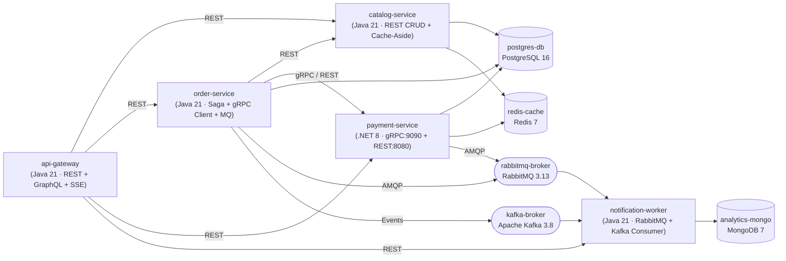

# MAVIS OmniShop Studio — Comprehensive Microservices Test Suite

Production-grade **Polyglot (Java 21 Spring Boot 3.4 + .NET 8 ASP.NET Core)** reference architecture engineered to thoroughly test **every capability** of **MAVIS Static Analysis (C1–C3 / Change Impact / Architecture Rules)** and **MAVIS Studio Live** (3D SE Topology, OpenTelemetry Distributed Traces, Logs, Action Toolbox, Resilience, Chaos & Blue/Green Rollback).

---

## Architecture Overview (5 Microservices + 5 Real Infrastructure Stores)



## Full Protocol, API & Database Coverage

| Layer | Technologies & Patterns Included |
|---|---|
| **API Styles** | **REST CRUD** (`GET/POST/PUT/PATCH/DELETE`), **GraphQL** (`POST /graphql` + `GET /api/v1/graphql/storefront`), **gRPC HTTP/2 Protobuf** (`proto/payment.proto` between Java `order-service` → .NET 8 `payment-service:9090`), **Server-Sent Events (SSE)** (`GET /api/v1/stream/events`), **Health / Readiness / Version** (`/health`, `/actuator/health`, `/version`) |
| **Databases & Cache** | **PostgreSQL 16** (SQL relational: `catalog_products`, `orders_records`, `payments_records`), **MongoDB 7** (NoSQL document store: `notifications`), **Redis 7** (cache-aside with hit/miss metrics + distributed payment idempotency lock) |
| **Message Brokers** | **RabbitMQ 3.13** (`omnishop.events` topic exchange: `order.created`, `payment.settled`), **Apache Kafka 3.8 KRaft Native** (`order-events` streaming topic with OTel trace propagation) |
| **Polyglot OTel** | **Java OTel Agent 2.32.0** (OTLP HTTP/4318) + **.NET 8 OTel AutoInstrumentation 1.17.0** (OTLP gRPC/4317) |
| **MAVIS Contracts** | Digest-pinned [`docker-compose.yml`](docker-compose.yml) (`read_only: true`, non-root users, zero secrets), deterministic [`mavis-runtime.yaml`](mavis-runtime.yaml) with `seed:` hook, and [`studio-preset.json`](studio-preset.json) |

---

## Comprehensive MAVIS Studio Test Checklist

Import `https://github.com/MAVIS-Platform/mavis-omnishop-studio` into MAVIS and verify every workflow:

1. **Static Analysis & C1–C3 Diagrams**: Detects all 5 polyglot services (Java + .NET 8), 5 infra stores, REST/GraphQL/gRPC/DB/Cache/MQ edges, and JPA/Npgsql schemas.
2. **Preflight Auto-Config**: Zero unresolvable runner issues — reads `mavis-runtime.yaml`, detects `readinessPath: /health`, `role: infra`, and `POST /api/seed`.
3. **LiveProbe Full-Graph Traffic**: Target `GET /api/v1/storefront/live-flow` on `api-gateway` (see `studio-preset.json`) to light up **all 5 microservices + all 5 infra nodes** in a single read-only GET call.
4. **Chaos & Change Impact (`PAUSE` / `STOP` / `RESUME` / `START`)**:
   - `PAUSE payment-service` → watch `order-service` gRPC calls fail, `api-gateway` return `503`, and 3D edges turn red/orange.
   - `SET_ENV api-gateway CIRCUIT_BREAKER_ENABLED=true` → repeat `PAUSE payment-service` and observe `[RESILIENCE] circuit-breaker=OPEN` fallback in Logs!
5. **Horizontal Scaling (`SCALE 1..3`)**: Scale `catalog-service`, `order-service`, or `payment-service` to `2x`/`3x` replicas.
6. **CPU & Load Stress (`THROTTLE_CPU` + `SET_LOAD`)**: Throttle `order-service` to `20%` CPU and push `SET_LOAD 20 rps` to observe p95/p99 latency growth.
7. **Live Architecture Tuning (`SET_ENV`)**:
   - `catalog-service`: `CACHE_ENABLED=false` → watch Redis cache bypass & PostgreSQL load increase.
   - `order-service`: `PAYMENT_PROTOCOL=rest` vs `grpc` → switch inter-service transport live!
   - `payment-service`: `FRAUD_CHECK_STRICT=true`, `ARTIFICIAL_LATENCY_MS=300`, `FAULT_ERROR_RATE_PCT=25`.
8. **Blue/Green & Canary (`SWAP_VERSION`)**: Swap `payment-service` between `:latest` (`v1`, fast) and `:v2-canary` (digest in `studio-preset.json`, strict fraud check + `120ms` scoring latency), then roll back cleanly.

---

## Run Locally (Developer Mode)

```bash
docker compose -f docker-compose.dev.yml up --build
curl http://localhost:8080/api/v1/storefront/live-flow
curl -X POST http://localhost:8080/graphql -H "Content-Type: application/json" \
  -d '{"query":"{ storefrontOverview { gatewayVersion productCount orderCount notificationCount } }"}'
```
